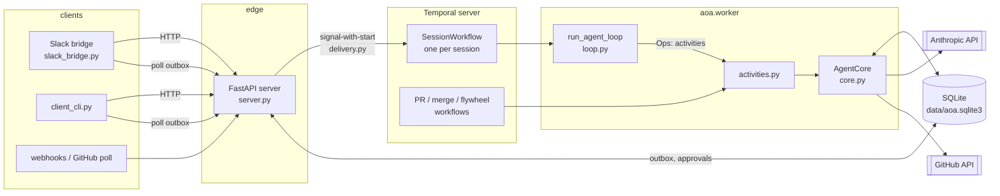

# Architecture

This is the orientation page. It says what the pieces are and how a message travels through them. The reference pages
under [`docs/reference/`](reference/) go one level deeper per subsystem; [`build-guide.md`](build-guide.md) says in what
order to build it.

## What aoa is

An "always-on" agent: one long-lived process-pair per session that receives events (you in Slack, a webhook, a timer),
runs a model-and-tools loop, and answers through a client. It is written once as plain async methods and can be driven
two ways: durably, by Temporal workflows, or in-process for tests.

Stack: Python 3.11+, the Anthropic SDK, Temporal (durable execution), FastAPI (HTTP edge), SQLite (all data).

## The picture

Read it left to right. Everything that reaches the agent is an **event**. Everything the agent says goes out through
the **outbox** table, which clients poll. Temporal history carries orchestration only (what step is next); the
conversation, results and state live in SQLite.

## One message, end to end

1. A client posts text to `POST /sessions/{sid}/messages` (or Slack/a webhook arrives). `server.py` authenticates it
   (bearer token for clients, shared secret for webhooks) and builds an `Event` (`events.py`).
2. `delivery.py` does a Temporal *signal-with-start*: it starts the session's `SessionWorkflow` if it is not running and
   hands it the event (`submit_event`). The `events` table dedupes by `dedupe_key`, so a redelivered webhook is dropped.
3. `SessionWorkflow` batches events for `AOA_BATCH_WINDOW` seconds, then runs a turn. A user event (priority 0) preempts
   a background turn and is *steered* into the step in flight via `append_results`.
4. The turn is `run_agent_loop`: call the model, run any tools it asked for, feed results back, repeat until the model
   stops or `AOA_MAX_STEPS` is reached. The loop does no I/O. It talks to the world only through the `Ops` protocol.
5. In the workflow, each `Ops` call is a Temporal **activity** (`activities.py`) that calls the matching `AgentCore`
   method. Each method is idempotent: it is keyed by a step key and stores its result with `Store.commit_step`, so a retry
   returns the stored result instead of calling the model or running the tool twice.
6. The agent speaks only through the `send_user` tool, which goes through `notify.Notifier`. It decides: deliver now, or
   hold in a digest (quiet hours, minimum interval). Replies, questions, approvals and urgent messages always go now.
7. The client polls `GET /sessions/{sid}/outbox` and renders each message by its `kind`.

## The central design decision

**The agent logic exists once, in `AgentCore`, and two runners drive it.**

| Runner | Used for | Where |
|---|---|---|
| `workflows.WorkflowOps` | production: every op is a Temporal activity or child workflow | `workflows.py`, `activities.py` |
| `direct.DirectOps` | tests and use without a server: plain in-process calls | `direct.py` |

That is why most tests need no Temporal server and no API key: `testing.FakeLLM` replays a script through `DirectOps`.
The price is a rule that must be kept: `loop.py` and workflow code must stay **deterministic** (no clocks, randomness,
or I/O), because Temporal replays them.

## Module map

Everything in `aoa/`. Docstrings are the source of these one-liners.

**Agent core**

| File | Role |
|---|---|
| `core.py` | `AgentCore`: every durable step (`prepare_turn`, `llm_step`, `run_tool`, `append_results`, `maybe_compact`, `warm_cache`) as an idempotent async method |
| `loop.py` | The model-and-tools loop. Pure; talks to the world only through `Ops` |
| `direct.py` | In-process `Ops`, and `handle_events` for tests |
| `llm.py` | Model access behind a small interface, and prompt-cache breakpoint placement |
| `batch_llm.py` | An LLM that sends calls through the Message Batches API (half price, slow); evals only |
| `prompt.py` | System prompt assembly built around one rule: never break the cached prefix |
| `compaction.py` | Context compaction when a conversation grows past the limit |
| `events.py` | `Event`, priorities, and `render_event_text` (fences untrusted text) |
| `tools.py` | The tool registry: schemas, handlers, core vs deferred |
| `memory.py` | File-based memory: profile facts, dated log, scratchpad, skills |
| `sandbox.py` | The agent's working directory with a sleep/wake lifecycle. Not isolation |
| `safety.py` | Command denylist, reviewer model, untrusted-text fencing, network guardrails |
| `notify.py` | `Notifier`: the only path from agent to client; digest and quiet-hours policy |
| `store.py` | The SQLite store (see [reference/store.md](reference/store.md)) |
| `config.py` | `Settings.from_env`: every `AOA_*` variable |
| `pricing.py`, `usage_report.py` | List prices and `python -m aoa usage` |
| `testing.py` | `FakeLLM`, `MemoryScheduler`, shipped in the package |

**Temporal layer**

| File | Role |
|---|---|
| `workflows.py` | All workflows: `SessionWorkflow`, `HelperWorkflow`, `RoutineWorkflow`, `GithubPollWorkflow`, `PrReviewWorkflow`, `MergePrWorkflow`, `EvalProposalWorkflow`, `EvalRunWorkflow`, `FlagScanWorkflow`, `FixPrWorkflow` |
| `activities.py` | Thin activity wrappers, one per durable step, plus the PR/merge/flywheel activities |
| `worker.py` | `python -m aoa.worker`: registers workflows and activities, ensures schedules |
| `delivery.py` | Signal-with-start into a session's workflow |
| `scheduling.py` | Routines and the GitHub monitor as Temporal Schedules |
| `search_attrs.py` | Registers the `Repo`, `PrNumber`, `Sha`, `Session` search attributes |

**Edge and clients**

| File | Role |
|---|---|
| `server.py` | FastAPI: messages and webhooks in, outbox out, approvals, merges, proposals |
| `slack_bridge.py` | Slack Socket Mode client; speaks only the HTTP API |
| `client_cli.py` | A thin terminal client |
| `__main__.py` | `python -m aoa usage | trace | flags | propose | proposals | evalruns` |

**GitHub pipeline** (see [reference/github-pipeline.md](reference/github-pipeline.md))

| File | Role |
|---|---|
| `github_monitor.py` | Poll for open non-draft PRs; decide which need a review |
| `pr_review.py` | The review task, schema, citation check, rendering |
| `gh_reviewer.py` | A separate GitHub identity so reviews can APPROVE / REQUEST_CHANGES |
| `pr_merge.py` | What to do with a PR given GitHub's view; the messages to send |
| `pr_resolve.py` | Resolve merge conflicts in a temp clone and push |

**Flywheel** (see [reference/flywheel.md](reference/flywheel.md))

| File | Role |
|---|---|
| `flag.py`, `flag_schedule.py` | Flag bad outcomes from stored traces; the daily scan |
| `eval_proposal.py` | Turn a flag into a proposed eval case for a human to accept |
| `eval_schedule.py`, `eval_compare.py` | Scheduled eval runs and baseline comparison |
| `fix_pr.py` | After Accept: draft a fix with a headless Claude Code session, open a PR |

Outside `aoa/`: `evals/` (the behaviour suite and graders), `tests/` (including recorded Temporal histories),
`deploy/` (launchd), `docs/`.

## Invariants that are easy to break

These are the rules a change must respect. Each is explained where it lives.

1. **Workflow code is deterministic and replay-compatible.** Any change to the commands a workflow issues needs a
   `workflow.patched("name")` guard. `tests/test_replay.py` replays recorded histories; never re-record one to make it
   pass. ([reference/workflows.md](reference/workflows.md))
2. **Steps are idempotent.** A state-changing step goes through `Store.commit_step` / `step_get` with a step key.
3. **Tools run at most once.** A failed tool is reported to the model as "effects unknown" and never re-run. Model calls
   are retried. ([reference/tools.md](reference/tools.md))
4. **The prompt prefix is fixed.** Volatile context goes in the new user message, never the system prompt, or the cache
   misses. ([reference/prompt-and-cache.md](reference/prompt-and-cache.md))
5. **External text is data.** Anything not typed by the authenticated user is wrapped and labelled untrusted before the
   model sees it. ([reference/trust-and-safety.md](reference/trust-and-safety.md))
6. **Merging is never a model tool.** Only a human click starts `MergePrWorkflow`.
