# The flywheel and the eval suite

Source: `aoa/flag.py`, `aoa/flag_schedule.py`, `aoa/eval_proposal.py`, `aoa/fix_pr.py`, `aoa/eval_schedule.py`,
`aoa/eval_compare.py`, `evals/`. The idea: **learn from real mistakes without letting the agent change itself.** A bad
outcome becomes a flag, a flag becomes a proposed test, an accepted test becomes a fix PR. A person decides at every
step, and nothing here is scheduled to spend money by itself except the optional eval schedule.

```mermaid
flowchart LR
    T[(steps + approvals<br/>SQLite traces)] -->|flag.scan, free| F[flagged]
    F -->|aoa propose<br/>human-started| D[eval_draft<br/>one model call]
    D -->|validate in subprocess<br/>N real runs| C{{Slack card}}
    C -->|Accept| A[evals/accepted/slug.json<br/>local branch eval/slug]
    A -->|Draft fix click| X[fix_run<br/>headless Claude Code, no shell]
    X -->|read diff, second click| P[verify, push, open PR]
    P --> H[aoa reviews, human merges]
```

## Step 1: flags (`flag.py`, #54)

`python -m aoa flags [--scan]` lists flagged bad outcomes; `python -m aoa trace <conv> [--json]` prints one conversation.
`scan` reads the `steps` and `approvals` tables and fills `flagged`, one row per conversation and reason, idempotently.
It costs nothing: no model call. Reasons:

| Reason | Meaning |
|---|---|
| `approval_denied:<id>` | The person denied an approval. Often the gate working, not a mistake |
| `max_tokens:<step key>` | A model output was cut off |
| `tool_errors:<tool>:<turn>` | A tool failed 3 or more times (`TOOL_ERROR_REPEATS`) within one turn |
| `cache_miss:<turn>` | The prompt cache missed within its lifetime and **nothing on our side explains it**. `llm_step` stores a cause code with each miss (`tools_system`, `history_shrank`, `message_changed`, `identical`, `no_previous`); a deploy that changes the tools or system prompt, and compaction, are expected and not flagged (`flag.EXPECTED_MISS_CAUSES`), and a step recorded before the cause was kept is skipped. One flag per missed turn (#72) |
| `reported:<kind>:<name>` | The model called `report_issue`. Unverified; capped at 20 open per conversation |
| `max_steps:<turn>` | The turn used every one of `AOA_MAX_STEPS` and was still calling tools |

`FlagScanWorkflow` (schedule `aoa-flag-scan`, `AOA_FLAG_SCAN_HOURS`, default 24) runs the scan daily and posts **one**
digest `alert` only when there are new flags. A retry cannot double-post (the client key comes from the rows). **It never
starts proposals.** Flags see only mechanical failures: a confidently wrong answer leaves no mark.

## Step 2: eval proposals (`eval_proposal.py`, #55)

`python -m aoa propose [--limit N]` starts an `EvalProposalWorkflow` per open flag that has no proposal yet. It is
**human-started**; nothing schedules it.

1. `eval_draft` makes one helper-model call over the untrusted-wrapped trace and gets a schema-enforced **spec**
   (`evals/spec.py`): events and graders chosen *by name* from a fixed registry with typed arguments. Nothing in a spec
   executes.
2. It validates the spec by running `python -m evals --spec FILE --runs N` in a **subprocess** that receives only
   `ANTHROPIC_API_KEY` (the runner monkeypatches `gh_call`, so it must never run inside the worker).
3. A case the agent always passes is dropped (`not_reproduced`); one it sometimes fails is shown as flaky. If the model
   judges there is no checkable mistake it writes none (`declined`), which is the common outcome for a flag that is only a
   working guard.
4. `eval_post_card` puts an `eval_proposal` card in Slack. **Accept** or **Reject** calls
   `POST /sessions/{sid}/proposals/{id}`. Accepting commits `evals/accepted/<name>.json` to a new local branch
   `eval/<slug>` in a temporary worktree: never main, never pushed. Accepted specs load into the suite through
   `evals/cases.py`.

Caps and cost: `AOA_EVAL_PROPOSALS_PER_DAY` (default 3; 0 = off; a capped workflow ends with `status: capped`) and
`AOA_EVAL_VALIDATE_RUNS` (default 2). The draft is metered as `<session>#eval-draft` in `aoa usage`; validation runs'
estimated cost is on the card (evals are not in the usage table).

Gotcha: a workflow that completed (including `capped`) keeps its id, so `aoa propose` cannot start the same flag again;
the id-reuse policy allows a restart only after a *failed* run. A capped flag has no proposal row, so with the default
`--limit 1` it can sit first in the list, be refused, and make the command print "nothing to propose" while other flags
are open. Use a larger `--limit` to reach the rest.

## Step 3: fix PRs (`fix_pr.py`, #56)

After Accept, the card offers **[Draft fix]** (`POST .../proposals/{id}/fix` starts `FixPrWorkflow`; never the model,
never automatic; `AOA_FIX_PER_DAY` caps clicks).

1. `fix_run` works in a temporary worktree of `eval/<slug>` rebased onto the local main, on branch `fix/<slug>`. The case
   must still fail (trusted code, API key fine).
2. A headless Claude Code session (`ClaudeCodeAuthor`) edits files with **no shell** and no GitHub token or API key in its
   environment. It needs an explicit Claude credential: `AOA_CLAUDE_OAUTH_TOKEN` (from `claude setup-token`), or opt-in
   `AOA_FIX_USE_API_KEY=1`. A stripped service environment has no login, and the CLI reports that as exit 0 with
   `is_error`. Budget: `AOA_FIX_BUDGET_USD`.
3. This module checks the result **statically** (no fix code has run), refusing the paths and patterns listed in
   [trust-and-safety.md](trust-and-safety.md), then commits **locally** and records the commit id.
4. The card says nothing has run and nothing is pushed. The person reads `git diff main...fix/<slug>` and clicks
   **[Run checks + open PR]** (signal `open_pr(token)`; the token is that attempt's run id prefix, so a stale button is
   ignored). With no click for a day, the worktree and branch are discarded.
5. Only then `fix_open_pr` runs `verify_fix`: HEAD must still be the shown commit with a clean tree, then `pytest` (no
   tokens or keys, throwaway HOME), the case N times (all must pass), and the behaviour suite once (a failing hard case is
   re-run 3 times before it counts). Any failure is terminal. It then pushes `fix/<slug>` and opens a PR with
   before/after numbers.

Honest limits: the author can read the whole repo, so the numbers are not held-out; the local main is not fetched before
the rebase; the whole chain ran for real once (PR #60, closed unmerged) with an API key and never with an OAuth token or
from a Slack click.

## The eval suite (`evals/`)

`python -m evals [--runs N] [--case NAME] [--tag TAG] [--batch] [--list] [--spec FILE]` runs the behaviour suite against
the **real model**. Export only `ANTHROPIC_API_KEY`, not the GitHub token.

- Each run uses a throwaway data dir, an in-memory scheduler and a **fake GitHub** (`evals/runner.py::_fake_gh_call`
  replaces `gh_call` with a recorder); `external_send` is already a stub.
- A case (`evals/cases.py`) has scripted events and a list of **graders**: deterministic Python over the run's outbox,
  tool calls and recorded effects (`evals/graders.py`). There is no LLM judge. Graders have canned-run unit tests in
  `tests/test_evals.py`, which run in the default `pytest` with no model.
- A case is `hard` (a safety rule; must pass every run, else a non-zero exit) or `soft` (policy; watch the pass rate).
- Results go to `evals/results/*.json` (git-ignored) with an estimated cost from list prices.
- Cost: a full default suite at 3 runs per case is about $0.35 and roughly a minute, because runs share a cached prefix.
  `--batch` halves the price through the Message Batches API but takes minutes per round.
- **Hard review set**: `python -m evals --tag review-hard`. Ten PR diffs from this repo's own history
  (`evals/review_fixtures/`, rebuilt by `python -m evals.review_fixtures.build`): six where a real defect was later fixed
  and four fixed commits the reviewer should approve. Needles are loose keyword alternatives, so a miss can be wording:
  read `findings` in the results JSON before blaming the reviewer. About 9 minutes and a few dollars for 30 runs. Cases
  tagged `slow` are left out of a default run.
- `--paged` reviews the old way (the reviewer pages through the PR itself); `--second-pass` is an evals-only experiment.

Add a case whenever a behaviour is verified by hand or a bug is found.

## Scheduled evals (`eval_schedule.py`, `eval_compare.py`, #61, #64)

Off unless `AOA_EVAL_SCHEDULE_HOURS` > 0 and `ANTHROPIC_API_KEY` is set. The worker then keeps a Temporal schedule
`aoa-eval-run` that starts `EvalRunWorkflow` -> `run_scheduled_evals` (never retried: it costs tokens).

- Runs the default behaviour suite at `AOA_EVAL_SCHEDULE_RUNS` per case.
- **Skipped** when the fingerprint (prompt, tools, safety, events, notify, all of `evals/`, accepted specs, model names) is
  unchanged since the last run and that run is under 7 days old.
- Per-case pass counts go to kv `eval_runs` (last 30; `python -m aoa evalruns`). A run with no regression becomes the
  `eval_baseline`.
- **Regression** = a hard case not passing every run, or a soft case losing more than 0.34 of its pass rate against the
  **best** of the last 5 green runs. It is posted as one `alert` per distinct set (kv `eval_last_posted`).
- A crash, timeout or bad key returns `status: error` and posts one alert. A report where **no case passed in any run** is
  also an error, not a regression: the harness grades a crashed run as a failed case. The next green run after any
  alert posts one "green again" update.
- A manual `python -m evals` run does **not** write to kv, so `aoa evalruns` does not show it.

Not done: a "frontier" set, per-case history charts, comparing against `evals/results/*.json`.

## Recorded decisions

Deferred on purpose: Langfuse / OpenTelemetry, an LLM judge, a held-out set, thumbs-down signals. Proposals and fix PRs stay
human-clicked.
