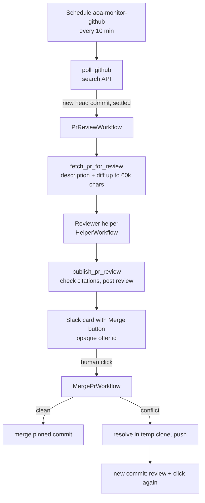

# GitHub pipeline

Source: `aoa/github_monitor.py`, `aoa/pr_review.py`, `aoa/gh_reviewer.py`, `aoa/pr_merge.py`, `aoa/pr_resolve.py`,
`aoa/activities.py`, `aoa/workflows.py` (`GithubPollWorkflow`, `PrReviewWorkflow`, `MergePrWorkflow`), `aoa/server.py`,
`aoa/slack_bridge.py`. It turns "a PR was opened" into "a review is in Slack, and one click merges it".



## 1. Monitor

`github_monitor.py` polls the search API for open, non-draft PRs of `AOA_GITHUB_USER` (one query, no model call unless a
PR is new). It tells the person once per head commit, remembered in kv `github_seen`. PRs to review wait in kv
`github_review_queue`.

**Settle window.** A PR touched in the last `AOA_REVIEW_SETTLE_SECONDS` (default 300) stays in the queue until a later
poll, judged by the PR's `updated` time, so a run of quick pushes costs one review of the last head. A manual
`temporal schedule trigger` right after a push therefore reviews nothing yet.

## 2. Review

`PrReviewWorkflow` handles one PR at one commit (workflow id includes the first 12 characters of the sha, and reuse is
rejected, so a commit is reviewed once).

- The reviewer is given the PR description and diff in its first message, fetched once by `fetch_pr_for_review` (up to
  60,000 characters, wrapped as untrusted; guarded by `workflow.patched("inline-diff")`). If the fetch fails the reviewer
  reads the PR with `github_read` instead. The 60k truncation is a known limit.
- The reviewer is a **helper** conversation, so it can use only `helper_ok` tools and cannot send, write or merge.
- Its output is schema-enforced (`pr_review.VERDICT_SCHEMA`): `verdict`, `summary`, and `findings`, each with `severity`,
  `file`, `line` (or null) and `comment`.
- The owner's per-repo notes come from `<AOA_DATA_DIR>/review-focus/<owner>__<repo>.md`, a local file, **never read from
  the PR**.
- `publish_pr_review` checks each finding against the PR diff (`pr_review.check_citations`): a file or line the diff does
  not show is removed from the finding, but the finding is always kept and the verdict never changes. Skipped if the head
  moved or the diff is unavailable.
- It posts a real APPROVE / REQUEST_CHANGES only through the reviewer identity (`gh_reviewer.py`), else a comment review.
  The review is posted once per `prreview-posted:<repo>#<n>@<sha>` key.

## 3. Merge

The Slack card carries a **Merge** button for an approved review. The button holds an opaque offer id (kv
`merge-offer:<id>`, created by `publish_pr_review`), validated by `server.py` against a strict pattern. A click calls
`POST /sessions/{sid}/merges/{offer_id}` and starts `MergePrWorkflow`, which **pins the reviewed commit**: if the PR has
moved on, it refuses (`stale`).

`pr_merge.py` maps GitHub's view of the PR to one of: merge, update the branch, resolve conflicts, wait, or stop with a
reason. Failure `action`s in `pr_merge.RETRYABLE` bring the button back; `needs_human`, `stale` and `tests_failed` do not.

## 4. Conflict resolution

When GitHub reports a conflict, `pr_resolve.py` (run by the worker, never in the agent sandbox):

1. clones into a temp directory, checks out the **exact reviewed commit** and merges the base into it (the token reaches
   git only through `GIT_CONFIG_*` env, never argv, the remote URL or `.git/config`);
2. asks a model to resolve each conflicted **file**, and validates the answer against the conflicted file;
3. requires every line *outside* the conflict hunks to survive verbatim and in order (`finish_resolution`);
4. runs the repo's tests (`AOA_TEST_COMMANDS` > `.aoa/test-command` **as on the base branch, never the PR's** > pytest in a
   fresh venv), as your user and not in a container, with an allowlisted environment, a throwaway HOME, and
   `AOA_RESOLVE_TEST_TIMEOUT`;
5. pushes to the PR branch **without force**, and never to a protected ref. The new commit needs its own review and its
   own click, so no AI-written resolution reaches the base branch without a second human click.

It refuses while GitHub auto-merge is on (checked before cloning and again before the push), and it never pushes a clean
merge (`no_conflict`: GitHub's status was stale). Because the tests run as your user, it is for your own PRs only.
Stale clone directories are removed when the worker starts.

## Model-facing GitHub tools

Separate from this pipeline: `github_read`, `github_list` and `github_write` (see [tools.md](tools.md)). The pipeline
itself never gives the model a merge capability.

## Operating it

```bash
temporal schedule trigger aoa-monitor-github            # poll now (respects the settle window)
temporal workflow list --query 'PrNumber=27'            # everything about one PR
python -m aoa trace 'prreview/<owner>/<repo>#<n>@<sha12>/helper/review'   # the reviewer's conversation
```

Reviews are metered as source `pr-review` in `python -m aoa usage`.
